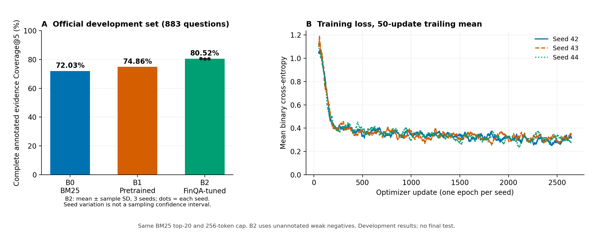

# M2.2 独立训练环境与B0/B1/B2开发实验

2026-10-30（Asia/Shanghai）。用户明确授权配置训练环境和模型对照，并明确允许使用本机NVIDIA GPU。范围为FinQA英文给定页证据排序，不修改线上中文模型或现有账号数据库，不访问最终测试、private_test或旧比赛保留题。

## 已验证环境

独立环境research/.venv，Python3.12.10，PyTorch2.10.0+cu128、Transformers4.57.1、numpy2.2.6、safetensors0.6.2；全部实际依赖锁定于research/requirements-training.lock.txt。pip check通过，目标环境36项研究测试全部通过，没有跳过。本轮未向应用backend/.venv或智投委依赖安装训练框架。

RTX5060 Laptop，8151MiB显存，驱动582.05，compute capability12.0。真实torch CUDA runtime12.8，编译架构包含sm_120。使用固定revision233902d25c440f23af6f7d6e94d2946bac0bee0a的cross-encoder/ms-marco-MiniLM-L6-v2（22713601参数，Apache2.0；原训练任务MS MARCO）。7个模型/分词器文件均核对本地SHA及上游Git blob/LFS身份，不执行远程模型代码，仅加载safetensors。

参考：[官方PyTorch历史版本安装说明](https://pytorch.org/get-started/previous-versions/)、[固定模型卡](https://huggingface.co/cross-encoder/ms-marco-MiniLM-L6-v2/tree/233902d25c440f23af6f7d6e94d2946bac0bee0a)、[Transformers4.57.1](https://huggingface.co/docs/transformers/v4.57.1/installation)。不是按页面显示的“最新”自动升级，而是安装后实际锁定上述版本。

CUDA wheel下载曾出现连接停滞/SSL断开；最终使用官方源断点续传，完整文件SHA256校验为fbde8f6a9ec8c76979a0d14df21c10b9e5cab6f0d106a73ca73e2179bc597cae后才安装，没有把未完成下载算作验证通过。

## 模型小批验证

实际在GPU使用2个配对、长度107运行FP32和BF16前向与反向。梯度均有限且非零，梯度L2范数2.7078628783，参数实际更新。固定小批25次更新后BCE从0.03009694降至0.00001054194；其中24次循环耗时0.5423秒。峰值已分配619192832字节（约590.5MiB），峰值保留681574400字节。

这是计算/优化检查，不是模型效果指标。smoke权重没有保存或用作B1/B2初始化；各阶段均重新加载原始底座。

旧通用资源检查采用4GiB物理内存余量门槛，本轮inventory时仅约2.78GiB，因此该通用检查保留skipped/false记录，没有改成通过。随后按预先说明的受控小模型方案实际执行上述GPU验证；可用结论仅针对实测的小模型与本次配置，不等同于所有模型的资源适配。

## 冻结实验

- 数据：固定FinQA commit0f16e2867befa6840783e58be38c9efb9229d742。6250训练题、883官方dev；1条非法gold题仍隔离，dev中7条超过5gold仍在主分母。
- 全部方法使用同一源序列化与BM25 top20。B0实际复算883题且与M2.1候选逐题一致；修复JSON key排序导致同分顺序变化的复现问题，不更改已冻结候选池。
- B1是未经本项目FinQA微调的现成排序模型；B2从相同底座重新加载，使用10689标注正例+31660未标注弱负例，共42349配对。训练可补入漏召回的gold，推理不能补。
- B2固定种子42/43/44，各1epoch、2647次更新、AdamW lr2e-5、weight decay0.01、10%线性warmup/线性衰减、裁剪范数1。微批2/累积8；不足16的最后窗口按真实样本数归一化。BCEWithLogitsLoss的稳定形式及梯度解释见research/README.md。
- 模型输入上限256、仅截断证据尾部，完整保留问题；训练60配对截断（含9正例），dev候选5配对截断、已召回正例0条截断。问题最长85token。只用长度审计描述风险，不把其gold标志送入模型。
- 不用dev挑选checkpoint，固定最终epoch。完整预测后独立读取dev gold评分；训练程序只读train标签。保存准备manifest、train输入/标签、原模型acquisition和代码hash；预测核验checkpoint config.json和safetensors，防止旧权重被套用新数据成绩。

## 开发结果

全部运行完成，pipeline-state为completed。主指标是全部标注证据进入前五的问题占比，绝非命中任一证据或股票收益率。

| 方法 | 完整Coverage@5 | 片段Recall@5 | nDCG@5 |
|---|---:|---:|---:|
| B0 BM25 | 72.0272% | 82.5677% | 0.7392 |
| B1 原预训练排序模型 | 74.8584% | 85.1921% | 0.7788 |
| B2 FinQA微调，三种子均值 | 80.5210% | 90.2405% | 0.8702 |

B2三次Coverage分别80.6342%、80.4077%、80.5210%；均值80.5210%，样本标准差0.1133个百分点，较B1均值高5.6625个百分点。每种子完整使用同一42349配对、2647次更新，最后窗口13配对；所有损失与梯度范数有限。训练耗时分别424.32、423.67、420.06秒，合计21.13分钟（不含下载/安装/推理）。

CandidateCoverage@20各方法均95.5832%，883题全保留，0缺预测；7题gold>5仍在分母。B2全部标注条件覆盖约84.24%，并未用条件子集替换主指标。

按97个公司代理组、2000次配对重采样（seed20261030）估计B2-B1差值：

| B2种子 | 提升，百分点 | 公司分组95%区间，百分点 | 覆盖改善题 | 覆盖退步题 |
|---|---:|---:|---:|---:|
| 42 | +5.7758 | [+2.1551, +9.0818] | 96 | 45 |
| 43 | +5.5493 | [+1.7340, +9.0805] | 96 | 47 |
| 44 | +5.6625 | [+1.7981, +9.1849] | 95 | 45 |

种子标准差与上述分组区间含义不同，不合并成3×883个独立样本。B1-B0点差+2.8313个百分点，但相同分组方法的区间约[-0.2801,+5.8032]，不据此宣布其普遍显著优于BM25。训练公司代理135个、dev97个，交集96个；公司-年度代理交集197，不是未见公司泛化结果，也不把代理报告ID重叠直接认定为原始报告版本泄漏。

B0 CPU页内检索均值约0.2601ms/题；B1 GPU重排约13.48ms/题，883题约11.91秒；B2均值约13.04、13.45、14.76ms/题。各自计时阶段不同，B1/B2含长度审计，不据此宣称端到端加速。

[机器结果](2026-10-30-b012-results.json) · [环境/smoke/训练/最终校验收据](2026-10-30-training-receipts.json) · [上游模型身份](2026-10-30-model-acquisition.json) · [图表数据](figures/b012-summary.csv) · [图表来源和处理记录](figures/b012-figure-manifest.json)。图由另一个已有Python环境中的Matplotlib3.10.9绘制，不把绘图依赖混入训练环境。实际查看导出PNG；条形从0起始，展示全部三个种子，训练曲线为50更新尾随均值，不删除原始日志。

## 审阅与限制

一次独立整体验证发现0Critical、2Important；训练来源绑定和模型config完整性两项均先写出失败回归，再修复通过。完整目标环境36项通过。不存在人工确认的金融冲突负例，B3继续等待90条pending任务复核；B2“金融微调”仅指FinQA任务微调，不能冒称专家金融冲突增强。

待完善的3项Minor：token长度审计尚无完整独立绑定收据；梯度累积数学单测尚未直接驱动完整训练循环（实际训练另有日志与smoke）；跨检索/重排的端到端耗时口径尚未统一。这些不扩成本轮额外改造，原始分阶段证据和限制保留。

完整入口另有重跑保护：在安装、预测或写入状态之前检查已存在的训练目录，避免误把completed状态或旧预测覆盖。独立PowerShell夹具先观察失败再修复，最终目标环境36项全部通过；不需要真实模型、GPU或原数据库参与该回归。

官方dev用于开发对照，不是最终盲测或已认证的未见公司泛化。按公司代理组配对bootstrap和三个训练种子波动分别报告；不把同报告问题/重复种子当新增独立样本。没有金融专家错误类型复核，不能仅由标注覆盖改善声称推理正确或真实业务收益提升。

复现入口research/run_b012.ps1及research/README.md；大产物在被Git忽略的research/artifacts/b012-20261030。
