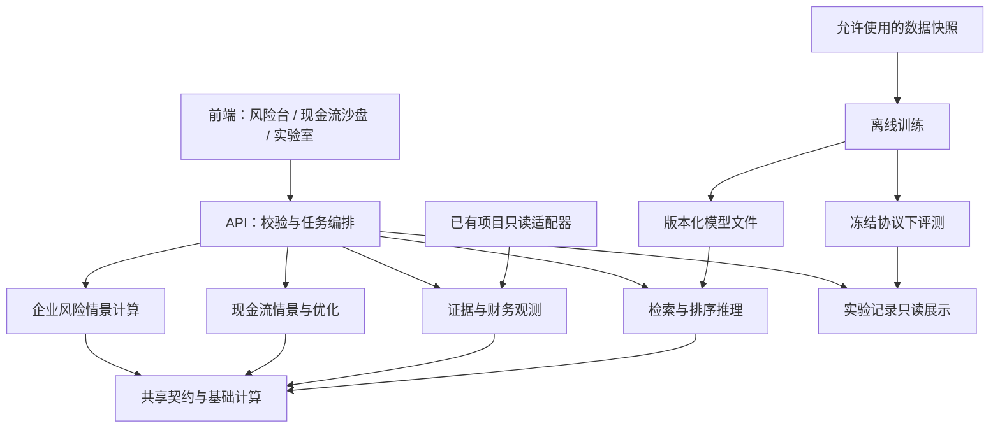

# 平台架构与第一功能切片设计

日期：2026-10-14。版本：1.1（深入审阅修订）。用户已认可 1.0 架构并要求继续审阅、细化；本版修正语义、数据与交互契约，未实现产品代码。修订依据与创新边界见 [审阅结论](../../reviews/2026-10-14-design-review.md)。

## 1. 目标与设计取舍

用户目标：以财务风险推演为主平台，包含中小企业现金流沙盘和训练评测实验室；借鉴学循交互并使用 Interactive-front-end；强化数学、算法和实际训练，服务学习研究、比赛与作品集。研发方向可以逐步调整。

首期使用者按研究/学习者设计：先分析案例、检查依据、调整假设。现金流模块后续面向企业资金管理场景验证。当前不承担实际授信审批或付款执行。

采用一个 React 前端、模块化 Python 后端、独立离线训练入口。同一代码库内先形成清楚的模块接口，避免起步就分布式部署。相比继续在旧报告页面堆功能，这样更方便独立开发；相比三套应用，减少证据、情景和实验元数据的重复实现。

前端建议 React + TypeScript + Vite；API 建议 FastAPI/Pydantic；M1 本机持久化采用 SQLite，规范化输入、来源清单和结果 JSON 与情景一起事务保存；PDF 是只读外部材料，较大的训练产物后续文件化管理。计算使用 Decimal，统计/训练依具体任务引入 NumPy、scikit-learn、PyTorch 等。具体依赖版本在实现时通过环境检查、锁文件和安装验证固定，本轮不安装。训练环境与应用环境独立锁定，模型文件不进入源码版本库。

M1 运行范围为单机单使用者、服务绑定回环地址；project_id 仅作上下文隔离，不能宣称已经实现多用户授权。公网或多人访问前另行设计身份与权限。M1 只实例化 contracts、evidence、risk、api、存储适配与对应前端；其余模块是能力边界，不先创建空服务或通用插件框架。

## 2. 模块依赖



第一版 API 中的计算为小规模同步请求。长训练不在 API 进程内运行；实验室最初读取离线运行结果。确有耗时需求后再增加持久任务 ID、状态查询和任务进程，不提前承诺后台恢复或服务端取消。

| 模块 | 拥有的数据/逻辑 | 输入与输出 | 不能承担 |
|---|---|---|---|
| contracts | 数据类型、单位、状态、版本规则 | 公共输入输出结构 | 导入 UI、数据库、模型框架 |
| evidence | 来源、报告、财务观测、证据位置 | 来源快照 → 可追溯观测与片段 | 将未复核值升级为已认证 |
| risk | 财务指标、回款敏感性、后续风险模型推理接口 | 观测 + 假设 → 派生值、公式、限制 | 生成每周企业流水，伪称违约概率 |
| cashflow | 收付款事件、现金平衡、情景与后续优化 | 事件 + 假设 → 逐周余额、缺口与方案 | 用年报填充未知经营流水 |
| retrieval | 语料筛选、召回、排序 | 问题 + 允许的证据快照 → 排序证据 | 读取 gold 标签作为模型输入 |
| experiments | 运行配置、数据/模型版本、指标与产物路径 | 运行记录 → 可比较的实验视图 | 自行改变训练划分或打分定义 |
| training | 数据管线、训练循环、checkpoint | 训练/验证清单 → 模型和日志 | 在网页请求中训练；选择最终测试成绩最好的参数 |
| evaluation | 划分验证、任务评分、错误分类 | 冻结预测 + 标签 → 指标及明细 | 将人工修订后答案当原始模型成绩 |
| web | 路由、选择状态、表单、图表和交互 | API 契约 → 操作反馈 | 权威财务计算、假造成功或进度 |
| api | 请求校验、编排、存储适配 | HTTP 输入 → 领域结果 | 把金融公式和模型训练写进路由 |

金融领域模块可以共同使用 contracts 和基础计算，但不能互相读取内部数据库表；跨模块以明确对象 ID、快照 ID 和结果结构传递。

## 3. 计划目录

```text
apps/web/src/
  app/                         导航、项目上下文与布局
  features/risk/               风险工作台
  features/cashflow/           现金流沙盘
  features/experiments/        实验结果视图
  shared/ui/                  按钮、抽屉、反馈等通用组件
  shared/api/                 生成/维护的契约客户端
backend/src/platform_app/
  contracts/                  共享结构
  evidence/                   来源与观测
  risk/                       财务指标和企业情景
  cashflow/                   事件、余额、模拟与优化
  retrieval/                  证据召回和排序推理
  experiments/                实验记录服务
  adapters/                   旧数据、文件、数据库适配
  api/                        HTTP 层
research/
  training/                   可独立运行的训练入口
  evaluation/                 指标、划分验证、错误分析
  notebooks/                  推导、复现与个人学习
  configs/                    可复现实验配置
tests/                        单元、契约及集成验证
```

此为目标结构，按功能切片逐步创建，不预先铺满空目录。文档已存在；其他目录尚未实现。

## 4. 核心对象与数据约束

| 对象 | 必须表达的内容 |
|---|---|
| SourceDocument | 来源 ID、企业 ID、报告期间、报告版本、文件 hash、来源 URL、公开日期及其精度/证据类别、获取日期、质量状态 |
| FinancialObservation | 观测 ID、指标、原始值、单位倍率、币种、规范值、期间起止或余额时点、合并/母公司口径、来源 ID、证据定位集合、分项质量状态 |
| EvidenceChunk | 片段 ID、来源 ID、位置、正文或表格结构、表头/单位上下文、抽取版本 |
| Scenario | 情景 ID、业务类型、输入快照 ID、用户假设、参数版本、公式版本、创建时间；假设不覆盖历史观测 |
| ScenarioResult | 情景版本、输入 hash、schema/formula/engine 版本、结果值与单位、计算明细、限制、来源关联；必须可追溯到具体输入 |
| CashEvent | 事件 ID、匿名企业/对手方、金额、币种、方向、类型、预计日期、信息可用日期、原账款 ID；实际结算另存，支持部分付款 |
| ExperimentRun | 运行 ID、任务类型、代码版本/源码 hash、配置、数据/划分/模型 hash、随机种子、环境、状态、指标和产物路径 |

金额 API 使用十进制字符串；后端 Decimal 计算，显示舍入和计算精度分离。缺失用 null 加原因，不用 0。流量期间与余额时点不能混用，年度与半年流量不能直接比较。

证据定位支持 value_page 与 header_pages 等多页关联；PDF 物理页码与印刷页码分开。M1 承诺页级定位和保存引用片段，不承诺自动识别坐标高亮。质量状态分别保存数值抽取复核、来源可追溯、时点可用性、报表审计意见；导入旧的 verified 标签不自动把其余维度设为通过。

记录的来源性质（公开/合成/授权企业）与数值角色（历史观测/用户假设/模型预测/派生计算）分开；AI 生成解释也单独标记。混合情景仍需保留每项输入的性质，不能只贴一个整体“真实数据”标签。

来源公开日期只精确到日时保留精度，不凭空补出首次公开时间；读取截止日过滤不能替代历史版本链验证。未知公开时间的材料可用于明确标注的当前描述性案例，不自动进入历史预测训练。

旧项目通过显式白名单导入。对外使用 source_id，不接收客户端任意本机路径；来源文件变化创建新快照，不就地修改已保存情景。不同来源的矛盾数值保留各自出处，由用户明确选择口径，不用平均值或 AI 自动覆盖。后续排序模型输出 EvidenceCandidate，未经字段校验和明确采用的候选不能直接覆盖 FinancialObservation；来源排序分数不能当成数值正确性认证。

## 5. 前端设计边界

必须使用 `interactive-front-end`，细节遵循其微交互规范。视觉目标先设为清晰、有层次的金融研究工作台；颜色与字体在第一轮页面原型中再确认，不把学循绿色或飞轮形状当必选。

- 导航按两个业务场景和实验室组织；当前企业、报告期间和情景始终可见。
- 选择风险指标后，图表、计算说明与原文详情联动；关闭详情恢复焦点与阅读位置。
- 主要按钮默认可试上移 2px、缩放 1.02、160ms 过渡；密集工具栏降低幅度，保证相邻内容和焦点环不被遮挡。
- 按压回落，触屏首次点击可操作，键盘可完整操作；减少动态效果时关闭位移和缩放。
- 输入即时显示草稿参数，后端计算才形成正式结果。快捷预览与已保存结果区分，结果保存绑定输入版本。
- 每次请求绑定项目、对象、情景与请求版本；迟到响应不覆盖新参数结果。错误状态同样校验归属。
- 未完成的算法显示未运行，不使用示范数字冒充训练结果；等待时间与计算阶段以实际能力为准。
- 原文未在本机可访问时给出来源链接和页码，不显示虚构预览。

### M1 操作状态与比较

固定三个区域：事实与来源、用户假设、结果与对比。每个参数都显示原值/假设属性；赊销比例 q 无可靠来源时由用户填写，不用默认值冒充企业实际值。结果旁直接显示“均匀销售假设下的稳态估算”，季节性限制不只藏在帮助抽屉中。

状态至少区分 `incomplete`（缺参数）、`dirty`（相对上次计算已修改）、`calculating`、`calculated-unsaved`、`saved`、`error`。旧结果可以保留供阅读，但要显示“对应旧参数”并禁用保存；计算失败不能把旧结果标成当前结果。滑块仅改变草稿，M1 点击“计算情景”才提交；不在前端暗中实现另一套权威公式。

每个输入提供数字框及可选滑块，允许精确输入、键盘调节和恢复上次计算参数。主控件按微交互规范抬升；不可交互的金额块不做强烈按钮式放大。

q 在界面显示百分比，在 API 中为 [0,1] 比例；80% 只转换一次为 0.8。编辑过程中的空字符串不自动变为 0，字段无效时保留用户输入并说明原因。M1 不承诺刷新恢复未保存草稿；站内离开未保存修改时提供保留编辑的选择。窄屏以证据/参数/结果切换呈现，图表关键数值有文本或表格入口。

默认比较锚点为同一输入快照、同一 q、Δd=0 的参照情景；用户选另一个已保存情景时，表格同时列参数差异。跨报告、币种、口径或公式版本不显示一个无说明的差值：M1 阻止直接数值比较并说明原因。更换参数不自动把比较锚点改成别的历史情景。

增加轻量的“为什么变了”详情：改了哪些假设 → 哪些来源固定 → 使用的公式 → 结果差值。点击输入定位假设控件或原文。Δd=0 的 0 表示占款变化为 0，不是企业应收余额为 0。多个参数同时变化时只列联合差额，不擅自分摊“因果贡献”；这种联动是项目交互贡献，不宣称学术首创。

前端先做页级原文查看；证据抽屉关闭返回触发控件。计算中与保存中分别显示；保存失败保留已计算输入和结果以便重试，不显示成功。

## 6. 首个可独立验收的功能切片 M1

名称：单企业回款延迟与应收资金占用敏感性。默认从现有惠天案例中适配一份完整年度报告；以白名单选择观测，若收入值、口径或出处不足则明确报缺项，不静默更换数据。惠天案例有明确供暖季节性，保留它作为“方法限制必须可见”的案例，而不是校准良好的均匀现金流示范。数学正确性用独立合成夹具验证。

用户流程：选择案例 → 查看收入等基础观测及质量状态 → 点击原文依据 → 输入赊销比例和延迟天数 → 查看稳态应收占款变化与限制 → 对比并保存情景 → 重新打开相同输入与结果。

此切片是静态比较分析，不是每周现金流预测。回款变化作为用户假设，而不是从年报中推断出的真实未来行为。

设报告期收入为 R、用户假设的赊销比例为 q、期间实际天数为 D、相对于参照情景的回款延迟为 Δd：

```text
日均赊销额 = R × q / D
应收占款变化 = 日均赊销额 × Δd
假设下的现金等价变化 = - 应收占款变化
```

适用假设：销售规模及结构稳定、收入按期间平均分布、其他现金流不变、暂不考虑税费、折扣、退货与客户违约。q 也不是“尚未收到的收入比例”。该式估计稳态的资金占用差额，不说明在第几周形成现金缺口；现金等价变化只放入公式解释，不作为“未来现金余额/实际可释放资金”主指标。不将报表账面净额周转代理当成客户实际账期，也不把期末应收余额用作平均稳态差额的直接上限。

M1 输入范围：R 为非负有限十进制金额、q 在 [0,1]、D 为报告期间首尾均计入的实际天数、Δd 在 [0,90] 天且允许小数。范围是首版交互限制，不代表金融学边界。缺少基准实际账期 d0 时不提供提前回款/释放资金情景；以后如增加负 Δd，需显式说明 d0 的来源或假设并约束 d0+Δd≥0。本版先不加该参数。

R、D 由服务端锁定的观测与报告期间取得，不能由客户端另传未关联的值替换。首版仅开放已适配的完整年度报告；纯计算测试覆盖闰年等合法期间，半年/季度产品支持另行评审季节性与可比性。q 无法估计时停留在参数缺失状态；可用独立合成演示学习操作，不静默为真实案例赋 q=0.8。

Decimal 计算统一 34 位有效数字，不逐步舍入日均额；先算 R×q×Δd，再除 D，最后按 ROUND_HALF_UP 量化到 0.01 元。规范值是有限普通十进制字符串：R 最多 18 位有效数字、6 位小数；q 最多 6 位小数；Δd 最多 2 位小数；各输入字符串最长 32 字符。拒绝 NaN/Infinity、科学计数法及超限值，不静默截断来源精度。输出保留公式、操作数、最终舍入前表示及版本；不把等价变化加到缺少同口径基准的现金余额上。界面精确到分只是显示约定，不代表经济估计准确到分。

示例仅为单元测试夹具：R=3650000 元、q=0.8、D=365、Δd=15，稳态应收占款增加 120000 元，假设下现金等价变化 -120000 元。该数据不属于真实企业。另以 R=100、q=1、D=365、Δd=90 检验不逐日舍入：输出 24.66 元，而不是先把日均额舍入为 0.27 再得到 24.30 元。

### M1 接口意图

- GET 案例列表及版本；GET 案例详情与观测、证据位置。
- POST 回款敏感性计算：输入案例快照与参数；返回计算结果及公式、输入版本。
- POST 保存情景：只接受快照 ID、参数、预期版本和请求键；服务端读取可信快照并重算，客户端结果和自报 hash 不作为正确性依据。
- GET 已保存情景：恢复参数、结果和证据引用，来源版本变化显示差异。

具体 URL、结构类型、文件和测试在 M1 实施计划中统一固定；不提前为未来模块创建无实现的接口。

### M1 保存与重开契约

输入身份覆盖 schema/formula/engine 版本、观测快照及来源 hash、币种/期间/范围、规范化参数。小数去无意义尾零、负零归零，JSON 键序固定、UTF-8 编码，再计算 hash；显示名称与创建时间不参与计算身份。

一次 SQLite 事务写入情景、规范化输入、计算结果、来源清单和幂等键。幂等键作用域为 project_id+save 操作：同键同输入返回已保存记录，同键不同输入返回冲突；网络超时重试不得多生成一条。改名可独立保存描述，修改参数产生新计算版本，不覆写旧结果。

重开直接读取当时保存的输入与结果，展示当时引擎版本，不自动用新公式重算覆盖。原 PDF 缺失/已变化时仍可查看快照里的数值、出处片段、页码和来源 hash，同时标明“原文件当前不可核对”；来源外链是外部查看，不表示它仍是保存时的版本。用新版本重算另建情景，并保留父版本关联。

### M1 验收

1. 夹具计算正确；q=0 或 Δd=0 输出为 0；Δd 增大时占款估计非减；不逐日舍入且不允许无基准的负延迟。
2. 拒绝非有限值、越界参数、币种混淆、缺失收入；单位换算只做一次。报告期合法且实际天数正确，页面只开放首版适配的年度报告。
3. 历史观测与假设分开；真实案例来源可定位，缺项明确展示。训练资格状态不被修改。
4. 保存重开结果一致；参数变更后旧结果不会被保存为新情景。重复提交不产生意外重复版本。
5. 鼠标、键盘、窄屏与减少动态效果下核心操作可用；默认、等待、成功、错误及重试状态可验证。
6. 客户端伪造结果不改变服务端保存值；同键不同输入报冲突；保存中断不产生指向缺失输入的记录。
7. 来源原文件变化或缺失仍可重开旧快照，并明确无法核对的部分；跨口径比较被阻止；缺 q 不展示冒充事实的估计。

## 7. 后续功能切片

- M2：证据检索基线与离线实验记录，随后训练第一个重排序模型。与 M1 共享 evidence 契约；数据路线详见研究路线。
- M3：合成的 13 周现金流沙盘，支持账款回款时间变化、现金底线与情景比较。延迟导致预测窗口外的事件仍保留在待收列表，不能丢弃。
- M4：真实数据条件下的现金流预测与区间评估；优化模型在现金平衡和业务约束验证后接入。
- M5：有合格标签与时间划分后进行企业困境分类。可独立延后，不用演示案例替代合格训练集。

每个切片单独设计、实施和验收。M1 计算/契约开发与 M2 的训练数据实样核查、冻结检索基线可以并行，避免训练工作被视觉打磨无限推迟；训练实现仍在数据关卡后。新页面只展示已运行的实验结果。

## 8. 方向调整与下一步

变更按四项记录：改什么目标、影响哪些契约、哪些结果仍有效、下一阶段如何重排。已有结果保留方法版本；接口有破坏性变化时升级 schema 版本并明确迁移。

用户已审阅并认可 1.0，当前要求的深入审阅已形成 1.1。下一步编写 M1 实施计划与 M2 数据核查任务，执行时沿用已确认的总体目标。数据来源、昂贵训练资源或具体视觉选择如出现实质不确定性，再分别询问；本次研究创新是假设，不承诺成功或学术首创。
